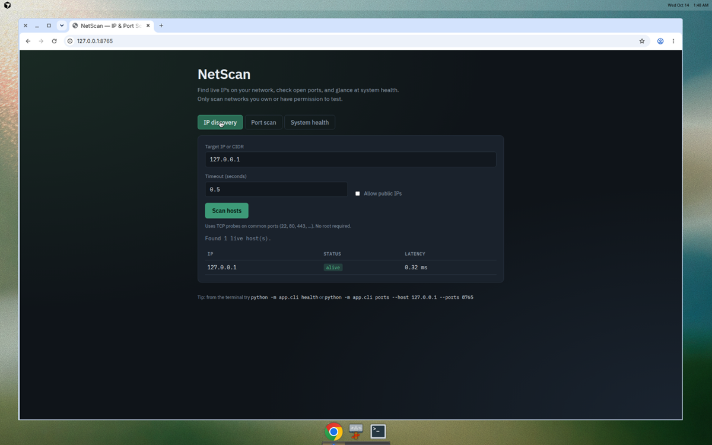
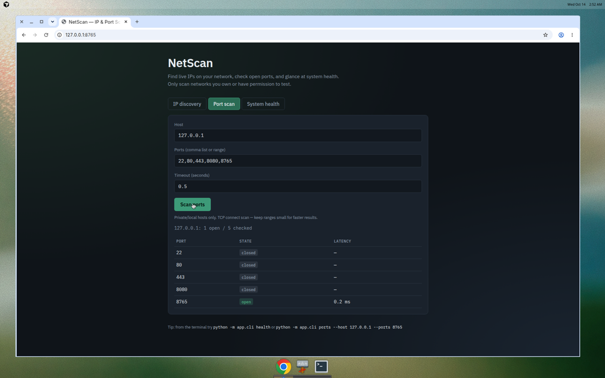
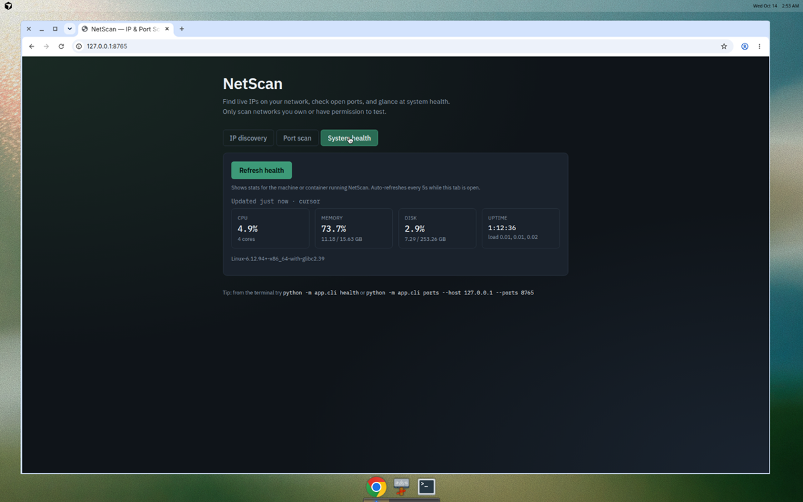

# NetScan

Simple **IP discovery**, **TCP port scanner**, and **system health** dashboard — built in Python, packaged with Docker, and ready for Kubernetes.


---

## What it does

| Feature | Description |
| --- | --- |
| **IP discovery** | Sweep a single IP or CIDR (e.g. `192.168.1.0/24`) and list hosts that answer common TCP ports |
| **Port scan** | TCP-connect scan a host for open ports (`22,80,443` or ranges like `1-1024`) |
| **System health** | Live CPU, memory, disk, load, and uptime for the machine/container running the app |

Public IPs are blocked by default so accidental internet scans are harder. You can opt in with a checkbox / `--allow-public` if you know what you are doing.

---

## Screenshots

IP discovery finding a live host on localhost:



Port scan showing open TCP ports:



System health (CPU, memory, disk, uptime):



> This project is meant to be run **locally** (or in your own Docker/K8s). There is no login on the web UI, so do not expose port `8765` to the public internet.

---

## Architecture

```text
Browser / CLI
     │
     ▼
 FastAPI  (app/main.py)     Click CLI  (app/cli.py)
     │                           │
     ├────────────┬──────────────┘
     ▼            ▼
 scanner.py    health.py
 (async TCP)   (psutil)
```

No root privileges, no raw sockets — just normal TCP connects. That keeps Docker and Kubernetes simple.

---

## Quick start (local Python)

```bash
python3 -m venv .venv
source .venv/bin/activate
pip install -r requirements.txt

# Web UI (127.0.0.1 = only your machine can open it)
uvicorn app.main:app --host 127.0.0.1 --port 8765
# open http://127.0.0.1:8765
```

### CLI examples

```bash
# Live hosts
python -m app.cli hosts --target 127.0.0.1

# Open ports
python -m app.cli ports --host 127.0.0.1 --ports 22,80,443,8765

# System health
python -m app.cli health
```

---

## Docker

```bash
docker compose up --build
```

Then open **[http://127.0.0.1:8765](http://127.0.0.1:8765)**.

> **Note:** Inside the container, `127.0.0.1` is the container itself (useful for demos). To scan your real LAN on Linux, set `network_mode: host` in `docker-compose.yml`.

---

## Kubernetes

```bash
# Build / load the image into your cluster first, then:
kubectl apply -f k8s/namespace.yaml
kubectl apply -f k8s/configmap.yaml
kubectl apply -f k8s/deployment.yaml
kubectl apply -f k8s/service.yaml

# Reach the UI from your laptop
kubectl -n net-scanner port-forward svc/netscan 8765:8765
```

Update `image:` in `k8s/deployment.yaml` once you push to a registry (Docker Hub, GHCR, etc.).

---

## Project layout

```text
app/
  main.py       # FastAPI routes + web UI
  scanner.py    # IP discovery + port scan
  health.py     # CPU / RAM / disk snapshot
  cli.py        # terminal commands
  models.py     # request shapes
  templates/    # single HTML page
k8s/            # namespace, config, deployment, service
Dockerfile
docker-compose.yml
```

---

## Safety

- Default allow-list: private ranges (`10/8`, `172.16/12`, `192.168/16`, `127/8`)
- Max CIDR size: 1024 hosts
- Max port range size: 5000 ports per scan
- **Do not** scan networks without authorization
